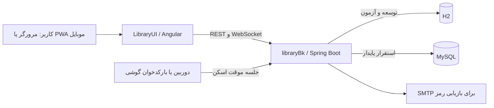

# بک‌اند سامانه مدیریت کتابخانه | libraryBk


[](https://github.com/saadati-mohammad/libraryBk/actions/workflows/ci.yml)

API و منطق سمت سرور برای [رابط وب LibraryUI](https://github.com/saadati-mohammad/LibraryUI). سرویس، ورود و نقش‌ها، کتاب‌ها، اعضا، امانت، رزرو، گفت‌وگو، پیوست فایل، ورود Excel، جست‌وجوی اطلاعات کتاب و ارتباط موقت اسکنر موبایل را مدیریت می‌کند.

> **شروع سریع توسعه:** JDK 21 را نصب کنید، `mvnw` را اجرا کنید؛ API روی `http://localhost:8079` و مستندات OpenAPI در `/swagger-ui.html` در دسترس است. پروفایل توسعه از H2 حافظه‌ای و Flyway استفاده می‌کند.

## فهرست

- [قابلیت‌ها و ارتباط با رابط](#قابلیت‌ها-و-ارتباط-با-رابط)
- [پیش‌نیازها و اجرای محلی](#پیش‌نیازها-و-اجرای-محلی)
- [راه‌اندازی و تنظیمات](#راه‌اندازی-و-تنظیمات)
- [پروفایل‌ها و دیتابیس](#پروفایل‌ها-و-دیتابیس)
- [حساب، نقش و احراز هویت](#حساب-نقش-و-احراز-هویت)
- [بازیابی گذرواژه](#بازیابی-گذرواژه)
- [API و اتصال فرانت‌اند](#api-و-اتصال-فرانت‌اند)
- [اسکن کتاب و جفت‌سازی موبایل](#اسکن-کتاب-و-جفت‌سازی-موبایل)
- [فایل‌ها، پشتیبان‌گیری و نگهداری](#فایلها-پشتیبانگیری-و-نگهداری)
- [توسعه و آزمون](#توسعه-و-آزمون)
- [امنیت و نکات عملیاتی](#امنیت-و-نکات-عملیاتی)
- [رفع اشکال](#رفع-اشکال)

## قابلیت‌ها و ارتباط با رابط



ماژول‌های اصلی: حساب عضو و کارکنان، مجوزدهی، کتاب و دسته‌بندی، اعضا، گردش امانت و رزرو، داشبورد، کاتالوگ عمومی، جست‌وجوی metadata از Open Library/Google Books، پیام‌رسانی STOMP، فایل‌های پیوست و واردسازی Excel. جزئیات کاربری و مسیرهای رابط در [README فرانت‌اند](https://github.com/saadati-mohammad/LibraryUI#قابلیت‌ها-و-راهنمای-استفاده) است.

## پیش‌نیازها و اجرای محلی

- JDK 21.
- Maven لازم نیست؛ Maven Wrapper پروژه موجود است. بار اول ممکن است برای دریافت Maven/dependency به اینترنت نیاز باشد.

### Windows PowerShell

```powershell
cd C:\path\to\libraryBk
.\mvnw.cmd spring-boot:run
```

### Linux / macOS

```bash
cd /path/to/libraryBk
chmod +x mvnw  # در صورت نیاز، فقط بار اول
./mvnw spring-boot:run
```

- API: `http://localhost:8079` (تغییر با `SERVER_PORT`).
- Swagger UI: `http://localhost:8079/swagger-ui.html`.
- OpenAPI JSON: `http://localhost:8079/v3/api-docs`.
- H2 Console: `http://localhost:8079/h2-console`؛ فقط برای توسعه محلی است. در پروفایل development فعال می‌شود و آدرس/اعتبار دیتابیس را از تنظیمات همان محیط بگیرید.
- اجرای فرانت‌اند: مخزن [LibraryUI](https://github.com/saadati-mohammad/LibraryUI) را روی پورت `4200` اجرا کنید. proxy توسعه، `/api` و `/ws-chat` را به این سرویس می‌فرستد.

اطلاعات H2 پیش‌فرض `jdbc:h2:mem:librarydb;` حافظه‌ای است و با توقف برنامه از بین می‌رود؛ از آن برای داده واقعی استفاده نکنید.

## راه‌اندازی و تنظیمات

تنظیمات از متغیرهای محیطی خوانده می‌شوند. فهرست کامل و قالب قابل‌کپی در [`.env.example`](.env.example) قرار دارد؛ فایل را به‌عنوان راهنما نگه دارید و secret واقعی را در secret manager محیط اجرا وارد کنید. خود Spring Boot فایل `.env` را به‌صورت خودکار بارگذاری نمی‌کند.

### اجرای نمونه با مقادیر محیطی در PowerShell

```powershell
$env:SPRING_PROFILES_ACTIVE = 'development'
$env:APP_ADMIN_USERNAME = 'admin'
$env:APP_ADMIN_PASSWORD = 'Choose-a-unique-long-password'
$env:APP_ADMIN_EMAIL = 'admin@example.org'
.\mvnw.cmd spring-boot:run
```

تغییر رمز seed از طریق متغیر محیطی فقط وقتی مدیر اولیه ساخته نشده اعمال می‌شود؛ برای حسابی که از قبل در دیتابیس است، از مدیریت حساب‌ها یا فرایند بازیابی استفاده کنید. `JWT_SECRET` در توسعه مقدار آزمایشی دارد و باید در هر استقرار واقعی با مقدار تصادفی و حداقل ۳۲ بایت جایگزین شود.

| متغیر | کاربرد | پیش‌فرض/نکته |
| --- | --- | --- |
| `SERVER_PORT` | پورت HTTP | `8079` |
| `SPRING_PROFILES_ACTIVE` | پروفایل فعال | `development` |
| `DB_URL`, `DB_USERNAME`, `DB_PASSWORD` | اتصال دیتابیس | H2 حافظه‌ای در توسعه؛ هر سه مقدار MySQL در production لازم‌اند |
| `JPA_DDL_AUTO`, `JPA_DIALECT`, `FLYWAY_ENABLED` | اعتبارسنجی schema و مهاجرت | `validate`، dialect متناسب با DB، `true` |
| `JWT_SECRET`, `JWT_EXPIRATION` | امضای JWT و مدت اعتبار برحسب ثانیه | secret production اجباری؛ زمان پیش‌فرض `86400` |
| `APP_ADMIN_USERNAME`, `APP_ADMIN_PASSWORD`, `APP_ADMIN_EMAIL` | مشخصات مدیر اولیه و ایمیل بازیابی | در دیتابیس خالی seed می‌شود؛ بدون مقادیر پیش‌فرض در production |
| `MEMBER_REGISTRATION_ENABLED` | اجازه ثبت‌نام عمومی عضو | در production به‌طور پیش‌فرض `false`؛ فقط با فعال‌سازی آگاهانه باز شود |
| `MEMBER_REGISTRATION_ENABLED` | اجازه ثبت‌نام عمومی عضو | در production به‌طور پیش‌فرض `false`؛ فقط با فعال‌سازی آگاهانه باز شود |
| `PASSWORD_RESET_ENABLED`, `PUBLIC_APP_URL` | روشن‌بودن بازیابی و مبدأ پیوند ایمیل | URL عمومی رابط؛ در production HTTPS |
| `MAIL_HOST`, `MAIL_PORT`, `MAIL_USERNAME`, `MAIL_PASSWORD`, `MAIL_FROM` | ارسال ایمیل بازیابی | مشخصات SMTP معتبر لازم است |
| `MAIL_SMTP_AUTH`, `MAIL_SMTP_STARTTLS` | احراز هویت و TLS ایمیل | هر دو را در استقرار امن روشن نگه دارید |
| `CORS_ALLOWED_ORIGINS`, `WS_ALLOWED_ORIGINS` | مبدأهای مجاز REST و WebSocket | مبدأ دقیق رابط را بنویسید؛ wildcard نگذارید |
| `UPLOAD_DIR`, `UPLOAD_MAX_FILE_SIZE` | محل/حداکثر اندازه فایل پیوست | برای فایل‌های موردنیاز فضای پایدار تعیین کنید |
| `CLEANUP_ENABLED`, `CLEANUP_CRON` | پاکسازی فایل‌های موقت/ناقص | زمان‌بندی با cron شش‌فیلدی Spring |
| `RESERVATION_EXPIRE_CRON`, `LOAN_OVERDUE_CRON` | زمان‌بندی وضعیت رزرو و امانت | روزانه، قابل تنظیم |
| `OPEN_LIBRARY_BASE_URL`, `GOOGLE_BOOKS_BASE_URL`, `GOOGLE_BOOKS_API_KEY` | منابع جست‌وجوی کتاب | اختیاری؛ نتایج به پوشش و دسترس‌پذیری منابع وابسته است |
| `H2_CONSOLE_ENABLED` | فعال‌سازی کنسول H2 | فقط توسعه، در production خاموش |
| `APP_LICENSE_ENABLED`, `APP_LICENSE_KEY` | دروازه مجوز اختیاری | به‌طور پیش‌فرض خاموش |

در PowerShell می‌توان متغیر را قبل از اجرای برنامه در همان پنجره با `$env:NAME = 'value'` تنظیم کرد. در Linux/macOS از `NAME=value ./mvnw spring-boot:run` استفاده کنید. هیچ secret واقعی را در README، فایل قابل‌commit یا log قرار ندهید.

## پروفایل‌ها و دیتابیس

| پروفایل | دیتابیس و کاربرد |
| --- | --- |
| `development` | H2 حافظه‌ای برای کار محلی؛ SQL logging و H2 Console برای توسعه؛ مناسب داده آزمایشی |
| `test` | H2 جداگانه و اجرای مهاجرت‌های واقعی Flyway در آزمون‌ها |
| `production` | MySQL پایدار؛ URL و نام کاربری/رمز، JWT secret، مدیر اولیه و CORS باید صریح و امن تنظیم شوند؛ fallback به H2 ندارد |

Flyway مالک schema است و Hibernate با `ddl-auto=validate` فقط همخوانی entityها را می‌سنجد. برای تغییر ساختار، migration تازه اضافه کنید؛ migration اجراشده را ویرایش نکنید چون checksum آن ثبت شده است. فایل‌های migration در `src/main/resources/db/migration/h2` و `.../mysql` جدا شده‌اند و باید هر دو مسیر موردنیاز را هماهنگ نگه داشت. ارتقا را ابتدا روی نسخه پشتیبان/محیط staging اجرا کنید.

نمونه اجرای production (مقادیر نمونه‌اند؛ جایگزین secret store کنید):

```bash
SPRING_PROFILES_ACTIVE=production \
DB_URL='jdbc:mysql://db-host:3306/library?useSSL=true&serverTimezone=UTC' \
DB_USERNAME='library_app' DB_PASSWORD='<secret>' \
JPA_DIALECT='org.hibernate.dialect.MySQLDialect' \
JWT_SECRET='<at-least-32-random-bytes>' \
APP_ADMIN_USERNAME='library-admin' APP_ADMIN_PASSWORD='<unique-secret>' \
APP_ADMIN_EMAIL='admin@example.org' \
./mvnw -B spring-boot:run
```

## حساب، نقش و احراز هویت

- API از سیاست **deny-by-default** استفاده می‌کند. برای مسیر محافظت‌شده ابتدا `POST /api/auth/login` را با نام کاربری و گذرواژه صدا بزنید و JWT را در `Authorization: Bearer <token>` بفرستید.
- اولین مدیر فقط وقتی جدول حساب کارکنان خالی است از `APP_ADMIN_*` ساخته می‌شود. حساب‌های بعدی از صفحه مدیریت کارکنان رابط ساخته/ویرایش می‌شوند. در production مدیر اولیه و JWT secret اجباری‌اند و مقدار پیش‌فرض ندارند.
- رمز عبور با BCrypt hash می‌شود؛ رمز خام قابل بازیابی نیست. تغییر رمز با فرایند reset انجام می‌شود.
- نقش‌ها و active بودن حساب برای هر درخواست مجدداً کنترل می‌شود؛ غیرفعال‌سازی/تغییر نقش با JWT قدیمی هم مؤثر است. سامانه از حذف آخرین مدیر فعال جلوگیری می‌کند.
- احراز هویت WebSocket در پیام CONNECT با همان JWT انجام می‌شود. سرور هویت فرستنده را از principal معتبر می‌گیرد و به هویت ارسالی کلاینت اعتماد نمی‌کند.
- پیام‌ها و فایل‌ها به فرستنده/گیرنده همان گفتگو محدودند؛ مشاهده یا حذف بر مبنای شناسه تصادفی دیگران مجاز نیست.

نمونه درخواست:

```bash
curl -X POST http://localhost:8079/api/auth/login \
  -H 'Content-Type: application/json' \
  -d '{"username":"admin","password":"<local-password>"}'

curl 'http://localhost:8079/api/book?page=0&size=10' \
  -H 'Authorization: Bearer <token>'
```

در اجرای توسعه بدون override، مقدار پیش‌فرض محلی `admin` / `admin` است؛ این credential آزمایشی را در محیط واقعی به کار نبرید. روی سرور عمومی نیز اجازه دسترسی به Swagger/H2 را مطابق سیاست استقرار محدود کنید.

## بازیابی گذرواژه

- `POST /api/auth/forgot-password` با `{ "email": "..." }` پاسخ عمومی یکسان می‌دهد تا وجود حساب افشا نشود.
- اگر ایمیل متعلق به یک حساب باشد، پیوند تصادفی یک‌بارمصرف با اعتبار ۲۰ دقیقه ایمیل می‌شود.
- `POST /api/auth/reset-password` با `{ "token": "...", "password": "..." }` رمز را تغییر می‌دهد؛ حداقل طول رمز ۱۲ نویسه است.
- تنها SHA-256 توکن reset در دیتابیس می‌ماند؛ رمز تازه نیز BCrypt می‌شود. توکن منقضی/مصرف‌شده قابل استفاده نیست.
- برای تحویل واقعی ایمیل، `PASSWORD_RESET_ENABLED=true`، `PUBLIC_APP_URL` با HTTPS، و مقادیر معتبر `MAIL_*` را پیکربندی کنید. ایمیل مدیر اولیه از `APP_ADMIN_EMAIL` می‌آید و ایمیل کارکنان در صفحه حساب‌ها مدیریت می‌شود. SMTP نامعتبر/خاموش یعنی لینک قابل‌تحویل نیست.
- در پروفایل production بازیابی رمز نیز به‌طور پیش‌فرض غیرفعال است؛ پس از آماده‌سازی SMTP و URL عمومی، آن را آگاهانه فعال کنید.

## API و اتصال فرانت‌اند

مرجع دقیق مسیرها، schema و مدل‌های درخواست/پاسخ در Swagger UI و `/v3/api-docs` قرار دارد. گروه‌های اصلی:

| گروه | کاربرد |
| --- | --- |
| `/api/auth/**` | ورود، ثبت‌نام عضو (طبق تنظیم)، بازیابی/تغییر رمز |
| `/api/public/**` | کاتالوگ فقط‌خواندنی برای بازدیدکننده |
| `/api/book/**`, `/api/person/**` | مدیریت کتاب و اعضا توسط کارکنان |
| `/api/loan/**`, `/api/reservation/**` | گردش امانت و رزرو |
| `/api/dashboard/**` | آمار داشبورد |
| `/api/staff-accounts/**` | مدیریت نقش و حساب کارکنان با دسترسی مدیر |
| `/api/member-account/**` | داده حساب عضو احراز هویت‌شده |
| `/api/phone-scanner/**` | دریافت اسکن برای یک pairing کوتاه‌مدت |
| `/api/**` فایل‌ها و پیام‌ها | پیوست و گفت‌وگو، محدود به طرف‌های مجاز |

قرارداد و مدل‌ها را از OpenAPI دریافت کنید؛ query pagination سقف اندازه صفحه دارد. CORS REST و origin مجاز WebSocket جداگانه از `CORS_ALLOWED_ORIGINS` و `WS_ALLOWED_ORIGINS` تنظیم می‌شوند. در توسعه، frontend dev server از proxy استفاده می‌کند؛ در production reverse proxy باید هم مسیرهای `/api` و هم upgrade اتصال `/ws-chat` را به سرور بفرستد.

## اسکن کتاب و جفت‌سازی موبایل

اطلاعات کتاب با ISBN یا عنوان/نویسنده از Open Library و Google Books جست‌وجو می‌شود. نتایج ادغام‌شده و best-effort هستند، جامعیت جهانی ندارند و برای کتاب‌های ایرانی ممکن است کامل نباشند؛ رابط ورود دستی دارد. کلید Google Books اختیاری است.

| متد | مسیر | توضیح |
| --- | --- | --- |
| `POST` | `/api/book/scanner-sessions` | ساخت جلسه جفت‌سازی با مجوز کارکنان |
| `GET` | `/api/book/scanner-sessions/{id}/scans?afterSequence=0` | دریافت اسکن‌های جدید برای فرم دسکتاپ |
| `DELETE` | `/api/book/scanner-sessions/{id}` | بستن جلسه |
| `POST` | `/api/phone-scanner/sessions/{id}/scans` | ارسال ISBN از گوشی با توکن همان جفت‌سازی |

گوشی برای این endpoint به JWT کارکنان نیاز ندارد؛ توکن تصادفی و پرآنتروپی فقط مجوز ارسال به همان جلسه است. جلسه پس از ۱۰ دقیقه منقضی می‌شود، صف اسکن محدود و خواندن تکراری سریع حذف می‌شود و با restart سرویس از بین می‌رود. لینک/QR pairing را log یا عمومی نکنید. camera API مرورگر به HTTPS و اجازه دوربین نیاز دارد. بارکدخوانی که به‌صورت صفحه‌کلید HID عمل می‌کند مستقیماً در کادر ورودی می‌نویسد؛ پروتکل اختصاصی دستگاه نیازمند integration جداگانه است.

## فایل‌ها، پشتیبان‌گیری و نگهداری

- مسیر `UPLOAD_DIR` را روی فضای پایدار و فقط در دسترس سرویس قرار دهید. پوشه را از وب‌سرور عمومی سرو نکنید؛ download باید از API احراز‌شده عبور کند.
- برای حفظ سامانه، از **دیتابیس MySQL و پوشه فایل‌های پیوست** با برنامه منظم نسخه پشتیبان رمزگذاری‌شده بگیرید و بازیابی را نیز دوره‌ای امتحان کنید. خروجی H2 حافظه‌ای پشتیبان production نیست.
- کتاب و عضو با غیرفعال‌سازی soft-delete از فهرست فعال پنهان می‌شوند و سابقه گردش باقی می‌ماند. فایل پیوست هنگام درخواست حذف یا پاک‌سازی فایل موقت ممکن است واقعاً از دیسک حذف شود؛ نگهداری فایل با soft-delete کتاب/عضو یکی نیست.
- صفحه مدیریت فرانت‌اند برای کتاب و عضو فایل Excel با پسوند `.xlsx` و الگوهای نمونه همراه دارد؛ ستون‌های موردنیاز و قواعد ورود را از همان فایل نمونه و ماژول import بررسی کنید. قابلیت خروجی جامع گزارش‌ها در حال حاضر بخشی از سامانه نیست.
- jobهای زمان‌بندی‌شده رزرو منقضی، امانت دیرکرد و فایل‌های ناقص/قدیمی را طبق زمان‌بندی و تنظیمات پاکسازی مدیریت می‌کنند. `CLEANUP_DELETE_FILES_OLDER_THAN_DAYS` را با نیاز نگهداری فایل هماهنگ کنید.

## توسعه و آزمون

```bash
./mvnw test                 # آزمون‌های واحد و یکپارچه با پروفایل test و H2
./mvnw -B clean verify      # چرخه کامل Maven و گزارش آزمون
```

CI روی JDK 21 `clean verify` و اسکن آسیب‌پذیری dependency را اجرا می‌کند؛ dependency-check در workflow فعلی `continue-on-error` دارد، پس نتیجه آن به‌تنهایی gate شکست build نیست. آزمون‌ها روی H2 واقعی برنامه با migrationهای Flyway اجرا می‌شوند. برای آزمون دستی، محیط dev را روشن کنید و Swagger UI یا رابط Angular را به آن متصل کنید. اجرای MySQL محلی برای آزمون نیاز به سرویس MySQL جداگانه دارد.

### تغییر schema

1. Entity/DTO/سرویس و migration متناظر را اضافه/به‌روزرسانی کنید.
2. migration را برای هر دو dialect پشتیبانی‌شده (H2 و MySQL) هماهنگ نگه دارید.
3. `./mvnw clean verify` را اجرا کنید و گزارش migration را بررسی کنید.
4. migrationی که در محیطی اعمال شده را اصلاح نکنید؛ migration بعدی بسازید.

## امنیت و نکات عملیاتی

- TLS/HTTPS را جلوی برنامه فعال کنید، کلید JWT یکتا و قوی و گذرواژه مدیر قوی انتخاب کنید و دسترسی DB را به کمترین سطح لازم محدود کنید.
- H2 Console، SQL debug و secretهای توسعه برای محیط واقعی مناسب نیستند. پورت DB و upload را به اینترنت باز نکنید.
- CORS را به دامنه واقعی رابط محدود کنید. توکن، رمز، SMTP credential و pairing URL را log نکنید.
- اگر `APP_LICENSE_ENABLED` خاموش باشد، بررسی اختیاری license اجرا نمی‌شود؛ آن را فقط در صورت نیاز عملیاتی روشن کنید و `APP_LICENSE_KEY` را امن نگه دارید.
- خطاهای ورودی/مجوز را بررسی کنید و برای ارتقای schema یا تنظیمات production، ابتدا backup و محیط staging داشته باشید.

## رفع اشکال

| نشانه | بررسی |
| --- | --- |
| برنامه روی پورت بالا نمی‌آید | اشغال‌بودن `8079` را بررسی و `SERVER_PORT` را عوض کنید؛ لاگ startup و پیکربندی محیط را ببینید. |
| خطای اتصال دیتابیس در production | فعال بودن پروفایل، دسترسی شبکه DB، `DB_URL` و credentialها را بررسی کنید؛ production به H2 برنمی‌گردد. |
| خطای Flyway یا validate | اولین migration ناموفق و اختلاف dialect/schema را پیدا کنید؛ migration اجراشده را ویرایش نکنید. |
| 401 | JWT غایب/منقضی/نامعتبر است؛ دوباره login کنید. |
| 403 | نقش لازم یا مالکیت همان پیام/پیوست را ندارید؛ شناسه شیء مجوز را دور نمی‌زند. |
| ایمیل reset ارسال نمی‌شود | وضعیت `PASSWORD_RESET_ENABLED`، `PUBLIC_APP_URL`، SMTP/STARTTLS، آدرس فرستنده و لاگ ارسال را بررسی کنید. |
| گوشی اسکن را نمی‌فرستد | اعتبار ۱۰ دقیقه‌ای pairing، دسترسی گوشی به نشانی شبکه، HTTPS، مجوز دوربین و صف جلسه را بررسی کنید. |
| جست‌وجوی کتاب خالی است | شبکه و دسترسی providerها را بررسی کنید؛ منبع بیرونی کامل نیست و ورود دستی قابل استفاده است. |

## پشته فنی

Java 21، Spring Boot 4.1.1، Spring MVC، Spring Security، Spring Data JPA، WebSocket/STOMP، Bean Validation، Hibernate Envers، Flyway، H2، MySQL، springdoc-openapi و Maven Wrapper.
