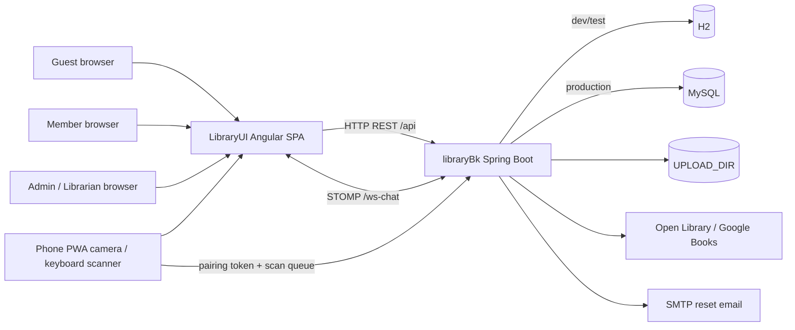

# System Map — Library Management System

**Discovery baseline:** 2026-10-11. This map describes the checked-out `feature/system-overhaul` branches at the Phase 0 audit start. Source code and migrations take precedence over older prose documentation. The backend companion map is in `libraryBk/docs/SYSTEM_MAP.md`.

## Architecture



The Angular router is lazy-loaded by feature. In local development, `ng serve` proxies `/api` and `/ws-chat` to port `8079`; production expects a same-origin reverse proxy or equivalent deployment. The API is stateless JWT over HTTP and STOMP. H2 is ephemeral in development/test; production configuration requires MySQL. Uploaded message files are stored on disk, not in an object-storage abstraction.

## Front-end modules and routes

| Route | Feature / entry component | Gate | User capability |
| --- | --- | --- | --- |
| `/` | `PublicHomeComponent` | Guest | Discover/search public catalog |
| `/catalog` | `PublicCatalogComponent` | Guest | Search/filter/paginate public books |
| `/categories` | `PublicCategoriesComponent` | Guest | Browse subjects/categories derived from catalog |
| `/books/:id` | `PublicBookDetailComponent` | Guest | Read public book details/cover |
| `/login` | `LoginComponent` | Guest/public | Authenticate member/staff |
| `/register` | `RegisterComponent` | Guest/public; backend policy decides | Self-register member when enabled |
| `/forgot-password`, `/reset-password` | password recovery components | Guest/public | Request and consume email reset token |
| `/phone-scan` | `PhoneScannerComponent` | Pairing capability at API | Submit scans from camera/manual/HID phone input |
| `/account` | `MemberAccountComponent` | `authGuard + memberGuard` | Own profile, loans, reservations; reserve/cancel |
| `/dashboard` | `DashboardComponent` | `authGuard + staffGuard` | Summary metrics/recent records |
| `/book` | `BookComponent` | `authGuard + staffGuard` | Filter/CRUD/deactivate books, ISBN lookup, Excel import, local camera/HID and phone relay |
| `/person` | `PersonComponent` | `authGuard + staffGuard` | Filter/CRUD/deactivate members, profile photo, Excel import |
| `/loan` | `LoanComponent` | `authGuard + staffGuard` | Issue and return loans; view loan status |
| `/reservation` | `ReservationComponent` | `authGuard + staffGuard` | Fulfill/cancel and view list or Jalali calendar |
| `/staff-accounts` | `StaffAccountsComponent` | `adminGuard` | Create/update/deactivate/reactivate staff and assign ADMIN/LIBRARIAN |
| `**` | not-found page | Public | Recover from invalid route |

Shared UI includes RTL shell/header/footer, paginated list/filter base, confirmation dialog, modal, Jalali date input, Persian paginator labels, validated file picker, stored-image component, theme service and session-expiry notice. Global frontend authentication uses `AuthService`, `authInterceptor`, and role guards. The token and username/role are stored in browser `localStorage`; API authorization is authoritative.

## Backend module map

| Concern | Main source area |
| --- | --- |
| HTTP API | `controller/` |
| Business rules | `service/` |
| Persistence/query | `entity/`, `repository/`, `specification/` |
| Request/response contracts | `dto/` |
| Authentication/authorization | `security/`, `config/SecurityConfig.java`, `config/CorsConfig.java` |
| WebSocket/STOMP | `config/WebSocketConfig.java`, `security/StompAuthChannelInterceptor.java`, `controller/WebSocketController.java` |
| Exception contract | `exception/GlobalExceptionHandler.java`, `dto/ApiResponse.java` |
| Schema | `resources/db/migration/{h2,mysql}/` (Flyway); Hibernate validate only |
| Tests | `src/test/java/` (JUnit 5 + Spring integration tests using H2) |
| Automation | `.github/workflows/ci.yml` (JDK 21 `clean verify`; dependency scan is continue-on-error) |

## Data model (current)

```mermaid
erDiagram
  PERSON ||--o| MEMBER_ACCOUNT : "optional login"
  PERSON ||--o{ BOOK_LOAN : borrows
  BOOK ||--o{ BOOK_LOAN : loan_history
  PERSON ||--o{ RESERVATION : places
  BOOK ||--o{ RESERVATION : requested
  MESSAGE o|--o{ MESSAGE : replies_to
  MESSAGE o|--o{ FILE_ATTACHMENT : attaches
  STAFF_ACCOUNT {
    bigint id PK
    string username UK
    string display_name
    string email UK
    string password_hash
    enum role
    boolean active
  }
  MEMBER_ACCOUNT {
    bigint id PK
    string username UK
    string password_hash
    bigint person_id FK_UK
  }
  BOOK {
    bigint id PK
    string title
    string author
    string isbn10
    string isbn13
    int copy_count
    boolean active
    string shelf_location
  }
  PERSON {
    bigint id PK
    string first_name
    string last_name
    string email UK
    string national_id UK
    boolean active
  }
  BOOK_LOAN {
    bigint id PK
    bigint person_id FK
    bigint book_id FK
    date loan_date
    date due_date
    date return_date
    enum status
  }
  RESERVATION {
    bigint id PK
    bigint person_id FK
    bigint book_id FK
    date reservation_date
    date expiry_date
    enum status
  }
  MESSAGE {
    bigint id PK
    string sender
    string recipient
    bigint parent_message_id FK
    datetime delete_date
  }
  FILE_ATTACHMENT {
    bigint id PK
    bigint message_id FK
    string file_path
    string upload_status
  }
  PASSWORD_RESET_TOKEN {
    bigint id PK
    string token_hash
    string username
    datetime expires_at
    datetime used_at
  }
```

Books aggregate `copyCount` rather than tracking individually barcoded physical copies. `Person` and `Book` have active flags for deactivation/soft deletion; loans, reservations, messages, and file attachments have separate lifecycles. Envers audits selected legacy domain entities but excludes large binary images; account/security actions do not yet have a unified searchable audit log. No persisted branch, fine, inventory-check, per-device, session, or permission entity exists at baseline. H2 migrations V1–V6 and MySQL migrations V1–V5 need provider-parity review.

## API inventory (controller-level)

Exact request/response schemas are in `/v3/api-docs` and Swagger UI. Security matcher order/policies are in backend `SecurityConfig`.

| API group | Controller | Purpose |
| --- | --- | --- |
| `/api/auth/**` | `AuthController` | login, conditional member registration, forgot/reset password |
| `/api/public/**` | `PublicCatalogController` | public read-only books, details, covers and categories |
| `/api/book/**` | `BookController`, `BookMetadataController`, `BookScannerSessionController` | staff book CRUD/deactivation, provider search, staff pairing sessions |
| `/api/phone-scanner/sessions/**` | `PhoneScannerController` | pairing-token scan submit (public matcher, capability authorized) |
| `/api/person/**` | `PersonController` | staff member CRUD/deactivation and picture |
| `/api/loan/**` | `BookLoanController` | issue/list/return loans |
| `/api/reservations/**` | `ReservationController` | staff create/fulfill/cancel/list active reservations |
| `/api/account/**` | `MemberAccountController` | own profile, loans, reservations and cancellation |
| `/api/dashboard/**` | `DashboardController` | summary |
| `/api/admin/staff-accounts/**` | `StaffAccountController` | admin staff account/role state |
| `/api/excel-import/**` | `ExcelImportController` | books/persons import |
| `/api/messages/**`, `/api/v1/files/**` | `MessageController`, `FileController` | authenticated message and attachment APIs; participant checks |
| `/ws-chat/**` | `WebSocketConfig`, `WebSocketController` | STOMP messaging; JWT authenticated on CONNECT |
| `/actuator/health/**`, `/actuator/info` | Actuator | public operational health/info as configured |

## Current role/permission matrix (source-verified)

| Actor | Public catalog | Member self-service | Book/person/loan/reservation/dashboard/import | Staff accounts | Messages/files | Phone scan submit |
| --- | --- | --- | --- | --- | --- | --- |
| Guest | Read | No | No | No | No | Only with session capability token |
| MEMBER | Read | Own account only (`/api/account/**`) | No | No | Authenticated; message/file participant checks | Only with session capability token |
| LIBRARIAN | Read | No | Yes (`ADMIN` or `LIBRARIAN`) | No | Authenticated; participant checks | Only with session capability token |
| ADMIN | Read | No | Yes | Yes (`/api/admin/**`) | Authenticated; participant checks | Only with session capability token |

The SPA guards improve navigation only; API `SecurityConfig` enforces roles. API security is stateless bearer JWT with BCrypt password hashes and no refresh/session registry. Public matchers include auth operations, GET `/api/public/**`, phone scanner capability endpoint, CORS preflight, docs/health and the STOMP handshake (CONNECT must authenticate). Other API paths require authentication. Staff role model is fixed to `ADMIN` and `LIBRARIAN`; member account is linked one-to-one to a person. Fine-grained permissions, branches/scopes, invitation/email verification, MFA, login throttling, session revocation/history, and unified audit center are not present at baseline.

## Existing automated verification inventory

- **UI:** Vitest component/service tests; TypeScript checks include app and E2E; ESLint; production Angular build; Playwright desktop Chromium and Pixel 5 projects. Browser specs cover public discovery, staff/member accounts, book/person CRUD, circulation, reservations, scanner flows, password recovery, accessibility, Persian controls/calendar, typography/contrast and projector/zoom scenarios.
- **API:** JUnit service/controller/security tests with real Spring context and H2/Flyway migrations; coverage includes authorization, soft delete, validation, public catalog, account isolation, staff account safety, reset token behavior, import, file path protection, scanner relay, reservation and concurrent copy issuance.
- **CI:** UI runs lint/typecheck/Vitest/build/npm audit and full-stack Playwright using a backend checkout; API runs `clean verify`; OWASP dependency check is explicitly `continue-on-error`.

## Phase 0 baseline (2026-10-11)

| Check | Result |
| --- | --- |
| UI clean dependency install | `npm ci --omit=peer` — PASS; 511 packages added, audit reported 0 vulnerabilities; npm emitted Angular animations deprecation warning |
| UI lint | `npm run lint` — PASS |
| UI typecheck | `npm run typecheck` — PASS (application and E2E types) |
| UI unit/component tests | `npm run test:ci` — PASS, 28 files / 158 tests; jsdom emits expected unsupported canvas `getContext` warnings; coverage 74.88% statements / 61.47% branches |
| UI production build | `npm run build` — PASS; initial transfer estimate 118.40 kB; CommonJS warnings for `qrcode` and `dijkstrajs` |
| API clean verify | `mvnw.cmd -B clean verify` — PASS, 152 tests, no failures/errors/skips; Flyway validated/applied H2 V1–V6 |
| UI full-stack Playwright E2E | `npm run e2e -- --workers=1` — PASS, 73 passed / 1 expected viewport-conditional skip out of 74; skipped desktop-only mobile-layout case passed in Pixel 5 project; two exploratory responsive checks and accessibility checks ran in Chromium |
| UI npm audit | `npm audit --omit=peer --audit-level=high` — PASS, 0 vulnerabilities |
| API lint / OWASP scan | No lint plugin/goal configured in Maven; OWASP dependency-check not run locally and CI treats it as continue-on-error |

## Initial verified gaps to investigate (not final severity assessment)

1. No per-copy barcode inventory: only aggregate book `copyCount`, so a return/stocktake cannot identify which physical copy is involved.
2. Existing mobile scanner is a temporary in-memory relay, not a registered/revocable device framework; no owner/station/config/health/audit persistence.
3. Authentication uses browser `localStorage` bearer tokens and lacks refresh/revocation/session inventory; assess actual threat model before changing architecture.
4. Static two-role staff authorization; there is no fine-grained permission editor or scoped branch model.
5. Envers covers selected domain rows but does not provide a security/admin action audit center; large binary columns are intentionally unaudited.
6. Member self-registration and password-reset email are production-disabled by default; safe operational onboarding needs explicit deployment configuration.
7. No fines, loan renewals, holds queue semantics, branch inventory, full reporting/export workbench, or UI chat workflow are evident from current routes/entities; validate expected scope and competitor fit.
8. Production MySQL migration parity has not yet been exercised in this local baseline; testcontainers/database availability must be checked.

See `docs/AUDIT_PROGRESS.md` for task states, risks and the next action. These are discovery leads, not claims of defects until Phase 1 scenario review.
